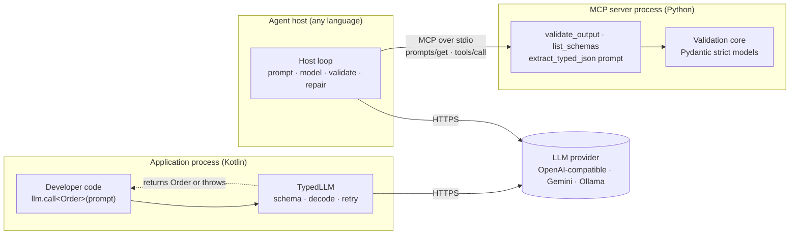
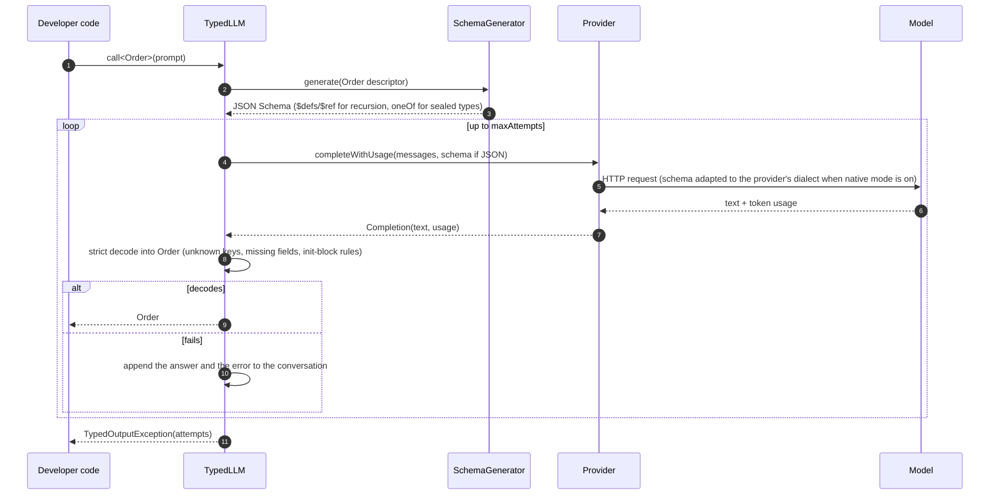
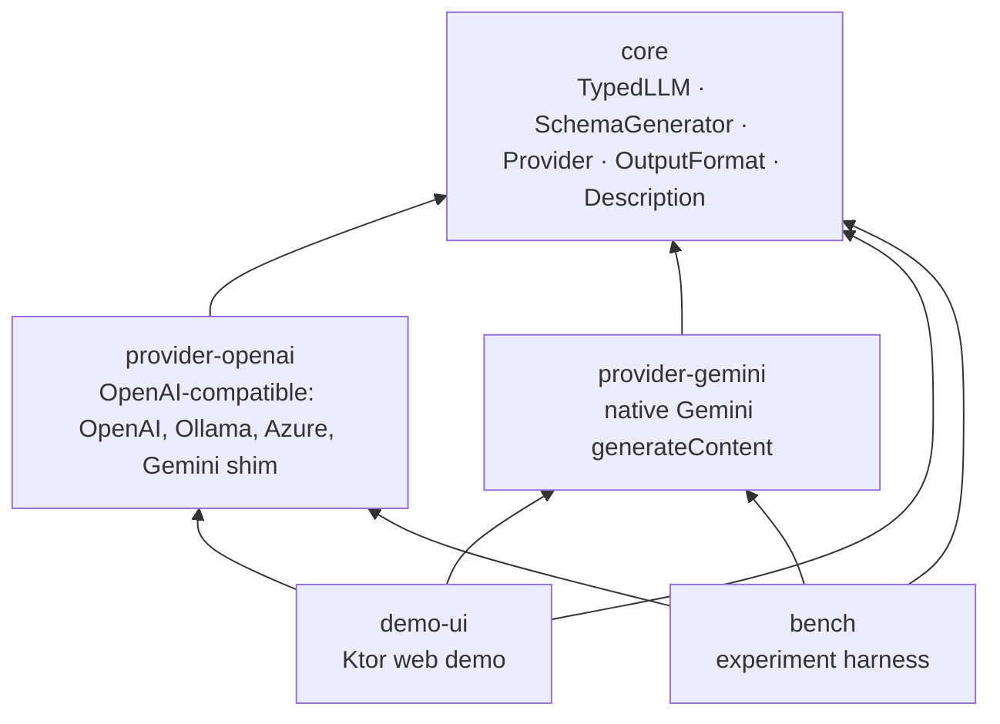
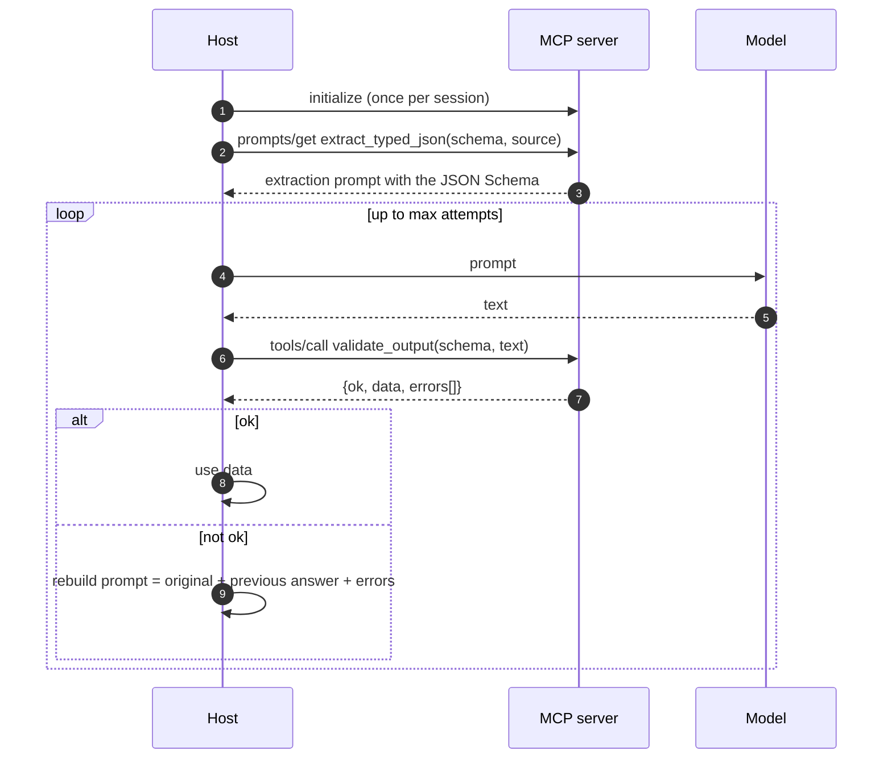
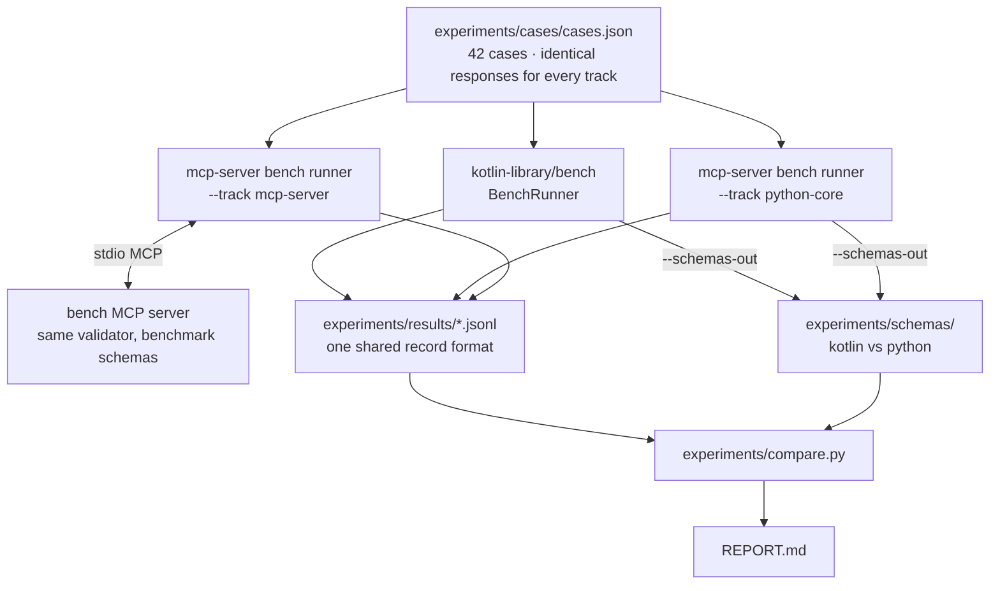

# Architecture

How the two approaches are built, where they share ideas, and how the experiment harness compares them.
Diagrams are Mermaid, so they render on GitHub. Rendered SVGs are in [`diagrams/`](diagrams/) for slides.

## 1. The system at a glance

Both approaches turn a model's text into a value a program can trust. They differ in **who runs validation** and
**where the typed value appears**.

| | Wrapper library | MCP server |
|---|---|---|
| Who calls the model | the library | the host |
| Who runs validation | the library, always | the host, by calling a tool (or the model, in tool-calling mode) |
| What the caller gets | a typed Kotlin object, or an exception with every attempt | a JSON object plus `ok`; the host must check `ok` before trusting it |
| Language reach | Kotlin/JVM only | any MCP client |

## 2. Wrapper library: one call

Points worth knowing:

- **No reflection.** `SchemaGenerator` reads the descriptor that the kotlinx-serialization compiler plugin generates, so every target type must be `@Serializable`. See [design-decisions.md](design-decisions.md#d2) for the trade-off.
- **Decoding is the validation.** A strict `Json` decoder rejects unknown keys, missing required fields, bad enum values and wrong JSON types. Domain rules (ranges, patterns, dates) live in `init` blocks that run during decoding.
- **Retries resend the conversation.** Each retry appends the bad answer and the error, so prompts grow with every attempt (measured in the [report](../experiments/results/REPORT.md#2-cost-what-each-track-sends-to-the-model)).
- **Native structured output is optional.** When on, providers receive the schema in their own dialect: `StrictSchema` for OpenAI strict mode, `GeminiSchema` for Gemini's `responseJsonSchema`. Both rewrite `oneOf` to `anyOf` and inline a root `$ref`, because those providers reject or silently ignore the originals. The library validates the response either way.

### Module layout

`Provider` is the extension point: implement `complete`, and override `completeWithUsage` to report tokens. Adding
Anthropic, for example, is a new module with no changes to `core`.

## 3. MCP server: host-driven validation

This is the mode the experiments measure. The host owns the loop; the server owns the prompt and the validator.

In **tool-calling mode** (`live.py --tool-calling`) the model decides whether to call `validate_output`. The model
might skip the tool, so the host validates the model's final text again before trusting it. That re-check is
the only thing that makes the result safe, and it's why the architecture spike said "MCP provides tool integration,
not an automatic type guarantee." [market-landscape.md](market-landscape.md#what-mcp-provides-natively) covers what
the MCP spec does and doesn't promise.

## 4. Experiment harness

The benchmark types are written in both languages with identical fields and rules. `compare.py` diffs the schemas
both sides generate, so an outcome difference can be traced to the library rather than to mismatched types.
